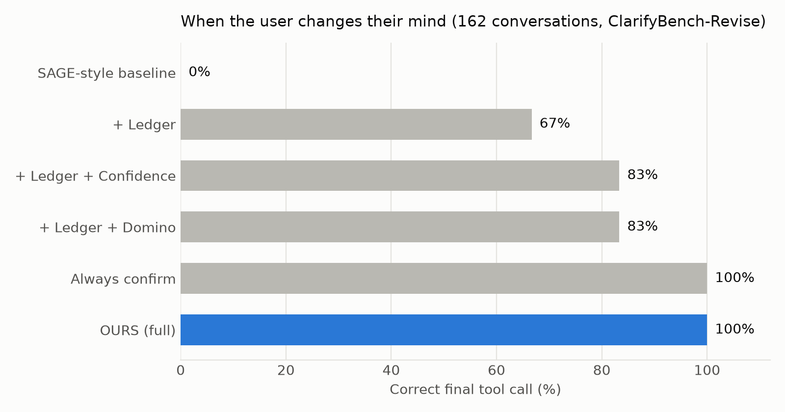

# Confidence-Aware Revision Handling for Structured Clarification Agents

Course project, Data Science for Conversational AI.
We extend **SAGE** (Suri et al., 2025, *Structured Uncertainty guided Clarification for LLM Agents*) so that the agent
handles users who **change their mind** before the tool call is executed.

## The problem
SAGE updates what it knows by **intersection**. That works when the user *adds* information, but breaks when the
user *changes* it: `{JFK} ∩ {LAX} = ∅`. It also cannot *forget* a value ("forget the destination").
ClarifyBench almost never tests this: only 12 of 1,393 follow-up messages change the user's mind, all after execution.

## Our extension
1. **Revision Ledger**: cross out the old value (keep it in history) and write the new one, instead of intersecting.
2. **Added value 1, confidence**: the user's change gets a weight from how sure they sound
   (SURE 0.95, PREFER 0.7, UNSURE 0.5). SAGE's own EVPI then decides whether to ask a confirmation question.
3. **Added value 2, domino**: when a parameter changes, re-check only the parameters that depend on it
   (e.g. origin -> destination, using ClarifyBench's real route table), so the agent never executes an impossible call.

## Results (ClarifyBench-Revise, 162 revision conversations, oracle reader)
| Version | Correct | Stale value | Exec. error | Avg. questions |
|---|---|---|---|---|
| SAGE (paper) | 0.0% | 83.3% | 0.0% | 1.25 |
| + Ledger | 66.7% | 33.3% | 16.7% | 2.73 |
| + Ledger + Confidence | 83.3% | 16.7% | 16.7% | 3.23 |
| + Ledger + Domino | 83.3% | 16.7% | 0.0% | 2.90 |
| Always confirm | 100.0% | 0.0% | 0.0% | 3.73 |
| **Ours (full)** | **100.0%** | **0.0%** | **0.0%** | **3.40** |


On the 54 normal conversations (no change of mind), every version gets 100%, so the extension does not hurt.
The exact confidence weights do not matter (see `sensitivity.py`): only their position relative to the 0.9 threshold.

## Setup
```
git clone <this repo>
cd <this repo>
git clone https://github.com/MananSuri27/ClarifyBench.git     # the benchmark data (inside this folder)
pip install matplotlib google-genai
```
For Gemini (only needed for `reader.py` and `chat.py`): set the environment variables `GEMINI_API_KEY`
and optionally `GEMINI_MODEL` (default `gemini-3.5-flash`). Never put the key in the code.

## Files
| File | What it does |
|---|---|
| `agent.py` | The agent: SAGE (score, EVPI, intersection) + ledger + confidence + domino, and the 6 versions we compare |
| `clarifybench_travel.py` | Reads the flight routes and city names directly from ClarifyBench's code |
| `tests.py` | 39 automated tests (math, explicit / ambiguous / infeasible, revisions, confidence, domino) |
| `demo_sage_breaks.py` | Shows SAGE breaking when the user changes their mind |
| `run.py` | Small domino example |
| `build_revise.py` | Builds **ClarifyBench-Revise** (216 conversations) from the real ClarifyBench Travel tasks |
| `evaluate.py` | Runs the 6 versions on ClarifyBench-Revise, prints the tables, saves `results.csv` |
| `plot_results.py` | Makes the figures `fig1`-`fig4` from `results.csv` |
| `sensitivity.py` | Tests other confidence weights |
| `reader.py` | Gemini reads any user sentence -> structured update + confidence (with an offline backup reader) |
| `chat.py` | Live demo: `python chat.py` (ours) or `python chat.py sage`; add `offline` to skip Gemini |

## How to run
```
python tests.py            # 39 passed
python build_revise.py     # 216 conversations
python evaluate.py         # result tables
python plot_results.py     # figures
python sensitivity.py      # robustness of the weights
python chat.py             # live demo (Gemini)
python chat.py ours offline
```

## Status / next steps
- [x] SAGE re-implementation + tests
- [x] Ledger, confidence, domino
- [x] ClarifyBench-Revise + evaluation + figures + sensitivity
- [x] Gemini reader + live demo
- [ ] Evaluation with the Gemini reader on natural-language versions of the conversations (Table B)
- [ ] Slides
- [ ] Report / paper

## Notes
- The authors released ClarifyBench and a ReAct baseline, but **not** the SAGE agent, so `agent.py` is our
  re-implementation of SAGE from the paper.
- Main results use an **oracle reader** (structured user turns); the Gemini experiment measures the realistic setting.S
- 
